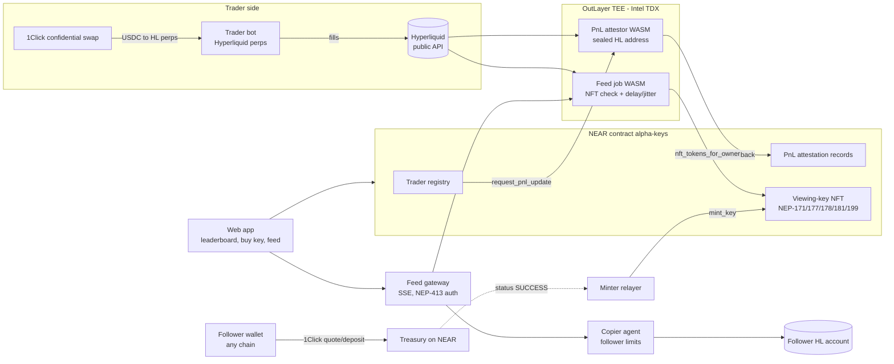

# Alpha Keys: private copy-trading with attested PnL and sellable viewing keys

> Status: **work in progress** for NEAR HACKATHON (Nov 2026). The Quickstart below is a placeholder. Every step gets filled in and checked from a fresh clone before submission. See [PLAN.md](PLAN.md).

## What it is

Good traders don't want to reveal their account: anyone who can see it can front-run them, copy them for free, or work out who they are. Followers, meanwhile, can't tell real track records from screenshots.

Alpha Keys fixes both sides:

1. **The trader stays hidden.** A trading agent runs Hyperliquid perps from an account funded through a **NEAR Intents confidential swap**, so nothing on-chain links the account to the trader.
2. **The PnL is public and attested.** A job running in a **TEE** (OutLayer, Intel TDX) holds the account address as a sealed secret. It reads fills and positions, computes PnL, drawdown, and Sharpe, and posts the result to a **NEAR contract** through OutLayer's yield/resume callback. Anyone can check the numbers; nobody learns the address.
3. **Access is sold as a key.** Followers buy a **Viewing Key NFT** (NEP-171). They can pay from any chain through **NEAR Intents 1Click**. Holding the NFT unlocks the trade feed: live for the premium tier, 60 s delayed for the standard tier.
4. **Copying is optional and capped.** An opt-in **copier agent** mirrors trades into the follower's own account, within limits the follower sets: max notional, max leverage, a daily loss cap, a liquidation-distance guard, and a kill switch.

The key NFT is transferable. Resale pays the trader a royalty (NEP-199).

## Architecture

The full component, data-flow, and threat-model write-up is in [docs/ARCHITECTURE.md](docs/ARCHITECTURE.md).

## NEAR tech used

| Tech | Where | Why |
|---|---|---|
| NEAR smart contract (Rust, `near-sdk` 5.x) | `contracts/alpha-keys` | Trader registry, PnL attestation records, Viewing-Key NFT |
| NEP-171 / 177 / 178 / 181 / 199 (`near-contract-standards`) | `contracts/alpha-keys` | NFT core, metadata, approvals, enumeration, royalties |
| OutLayer (TEE, yield/resume, sealed secrets) | `attestor/outlayer-job` | Sealed HL address, attested PnL, NFT-gated feed release |
| NEAR Intents 1Click Swap API (`confidentiality`, `dry: true`) | `scripts/`, `web/` | Confidential funding of the trader account; any-chain payment for keys |
| NEP-413 signed messages | `gateway/` | Follower proves NEAR account ownership to open the feed |
| NEAR wallet connector (`@hot-labs/near-connect`), `near-api-js` | `web/` | Wallet login, contract calls |
| (stretch) NEAR AI Cloud private inference | `attestor/` | Attested natural-language "why this trade" summary |
| (stretch) Agent API policy wallet (demo env) | `copier/` | Follower-side spending caps enforced in a TEE |

Not used: Shade Agents (deprecated as standalone tooling since 2026-04-19).

## Tracks

`defi`, `privacy`, `nfts`, `agents` (all that fit; see PLAN.md open questions on multi-track prizes).

## Quickstart for judges (placeholder, finalized on D7)

No funds or mainnet accounts are needed. Every 1Click call uses `dry: true`, and the contract is on **testnet**.

1. `git clone <repo> && cd alpha-keys && cp .env.example .env`. You see a `.env` with only public testnet values filled in.
2. `make check`. You see contract unit tests, `pnl-core` tests, gateway tests, and copier tests all pass.
3. `make demo-seed`. This replays a recorded fills fixture through `pnl-core`, and you see a PnL report (PnL, max drawdown, Sharpe) printed as JSON.
4. `near view <CONTRACT_ID> get_trader '{"trader_id":"alpha-1"}' --networkId testnet`. You see the trader record with its latest attested PnL and the OutLayer request id.
5. `pnpm --filter web dev`, then open http://localhost:3000. You see the leaderboard with an "Attested" badge per trader.
6. Click **Buy key → Pay from another chain**. You see a 1Click **dry** quote (amount in, deposit address omitted because the quote is dry).
7. Click **Open feed** without a key. You see `403 no viewing key`. After **Mint demo key** (testnet faucet flow), you see trades streaming with a 60 s delay.
8. `pnpm --filter copier dry-run` (or `uv run copier --dry-run`). You see the copier size each mirrored order and reject the ones that break the follower's caps, with the reason logged.

Hosted demo: _TBD (Vercel), kept up until at least Nov 25, 2026._ Demo video: _TBD (X post)._

## Pre-hackathon code disclosure

Only NEAR work done since **2026-10-19** is judged.

- **Reused baseline:** parts of my existing Hyperliquid bot fleet (HL REST/WebSocket client, fill/position parsing, order placement and sizing helpers). They are copied into `copier/` and `attestor/pnl-core` under `vendor/` or marked `// baseline:` headers, and listed here once imported:
  - _TBD: file list + original repo/commit_
- The first commit that imports baseline code is tagged `pre-hackathon`. The submission is tagged `hackathon-submission`. The diff link will go here: `compare/pre-hackathon...hackathon-submission`.
- Everything under `contracts/`, `attestor/outlayer-job`, `gateway/`, and `web/`, plus all NEAR Intents and OutLayer integration code, is new work for this hackathon.

## Libraries and AI assistance

Libraries are listed per package (`Cargo.toml`, `package.json`, `pyproject.toml`). Code is written with AI coding assistants (Cursor). That's allowed under the rules and disclosed here.

## Honest limitations

- Hyperliquid trades are public on its order book. A determined key holder could try to fingerprint the hidden account by matching copied trades to public fills. Delay, size jitter, and tiering reduce this risk but don't remove it. See [docs/ARCHITECTURE.md#threat-model](docs/ARCHITECTURE.md#threat-model).
- The viewing key is an **app-layer** access right enforced by the TEE job. It isn't a native Confidential Intents viewing key; none is public yet.
- NEAR Intents has no testnet. The demo uses `dry: true` quotes, plus at most a few tiny mainnet transfers made by the author.

## License

MIT, see [LICENSE](LICENSE).
