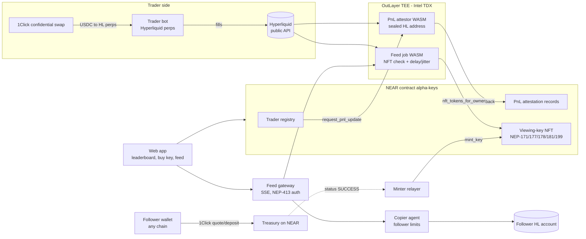

# Alpha Keys: private copy-trading with attested PnL and sellable viewing keys

The TEE is the design. The leaderboard says Attested only for an OutLayer callback whose code hash matches the pinned WASM. Until that callback is stored, the visible row is relayed from a fixture.

Live demo, no login: https://alpha-keys.vercel.app/

> Status: judge path is the Quickstart below. It runs from a fresh clone with no secrets and no funds. Submit as soon as this repo is public. Near Hunt only lists the project after the form is sent.

## What it is

Good traders don't want to reveal their account: anyone who can see it can front-run them, copy them for free, or work out who they are. Followers, meanwhile, can't tell real track records from screenshots.

Alpha Keys fixes both sides:

1. **The trader stays hidden.** A trading agent runs Hyperliquid perps from an account funded through a **NEAR Intents confidential swap**, so nothing on-chain links the account to the trader.
2. **The PnL is public and attested.** A job running in a **TEE** (OutLayer, Intel TDX) holds the account address as a sealed secret. It reads fills and positions, computes PnL, drawdown, and Sharpe, and posts the result to a **NEAR contract** through OutLayer's yield/resume callback. Anyone can check the numbers; nobody learns the address.
3. **Access is sold as a key.** Followers buy a **Viewing Key NFT** (NEP-171). They can pay from any chain through **NEAR Intents 1Click**. Holding the NFT unlocks the trade feed: live for the premium tier, 60 s delayed for the standard tier.
4. **Copying is optional and capped.** An opt-in **copier agent** mirrors trades into the follower's own account, within limits the follower sets: max notional, max leverage, a daily loss cap, a liquidation-distance guard, and a kill switch.

The key NFT is transferable. Resale pays the trader a royalty (NEP-199).

## Architecture

The full component, data-flow, and threat-model write-up is in [docs/ARCHITECTURE.md](docs/ARCHITECTURE.md).

## NEAR tech used

| Tech | Where | Why |
|---|---|---|
| NEAR smart contract (Rust, `near-sdk` 5.x) | `contracts/alpha-keys` | Trader registry, PnL attestation records, Viewing-Key NFT |
| NEP-171 / 177 / 178 / 181 / 199 (`near-contract-standards`) | `contracts/alpha-keys` | NFT core, metadata, approvals, enumeration, royalties |
| OutLayer (TEE, yield/resume, sealed secrets) | `attestor/outlayer-job` | Sealed HL address, attested PnL, NFT-gated feed release |
| NEAR Intents 1Click Swap API (`confidentiality`, `dry: true`) | `scripts/`, `web/` | Confidential funding of the trader account; any-chain payment for keys |
| NEP-413 signed messages | `gateway/` | Follower proves NEAR account ownership to open the feed |
| NEAR wallet connector (`@hot-labs/near-connect`), `near-api-js` | `web/` | Wallet login, contract calls |
| (stretch) NEAR AI Cloud private inference | `attestor/` | Attested natural-language "why this trade" summary |
| (stretch) Agent API policy wallet (demo env) | `copier/` | Follower-side spending caps enforced in a TEE |

Not used: Shade Agents (deprecated as standalone tooling since 2026-04-19).

## Tracks

`nfts`, `privacy`, `defi`.

`security` stays off this submission. The published record is relayed, not a live enclave proof. `agents` stays off: the copier dry-run does not spend.

## Quickstart for judges

No funds, no mainnet account, and no secrets. 1Click quotes are `dry: true`. The judge PnL row is **relayed** from a fixture (`submit_pnl`). `scripts/outlayer-publish.sh` is author-only: it publishes the worker, seals the address, and can call `request_pnl_update`. Judges do not run it.

1. `git clone https://github.com/ilerik/alpha-keys && cd alpha-keys && cp .env.example .env`. You see a `.env` whose filled-in values are public URLs and `DEMO_FEED=1`. Secret fields are empty.
2. `make check`. You see Rust tests, gateway tests, web tests, copier tests, and `leak check: no address-shaped hex`.
3. `make demo-seed`. You see metrics JSON (`pnl_usd_e6` 8000000, `max_dd_bps` 10, `sharpe_e4` 108098), then JSON lines: two orders and one `coin_not_allowed:DOGE` rejection.
4. The same metrics are what `submit_pnl` stored on `alpha-keys.testnet`. The transaction is `6uDLJJ5s9URhR79Gt6P97r9p54HPdgSEWWdgEuYpyekF`. Token `0` is a Delayed60 key. Judges do not deploy.
5. In one terminal, `pnpm --filter gateway start`. You see `gateway listening on 8787 demo=true`.
6. In another, `pnpm --filter web dev`, then open http://localhost:3000. You see Alpha One. The badge is Relayed and the numbers are the fixture (PnL 8 USD, drawdown 10 bps) until a callback row's code hash equals the contract's pinned WASM hash. That matching callback is the only Attested badge.
7. Open **Alpha One** and click **Buy key → Pay from another chain**. You see a dry quote for 5 Ethereum USDT into NEAR USDC: `dry` true, `amountOut` filled in, and `depositAddress` null.
8. Open **Feed**, click **Open feed**. You see `403 no viewing key`. Click **Mint demo key**. You see `Trades are streaming.` and ETH events.
9. Open **Verify**. You see the relayed record. Click **Check record**. You see `VERIFIED` and digest `c77fa93b9c667bfefa078b647e55333a42266d4f0b2dc000a45500e0b52881d7`. Click **Flip one byte**. You see `NOT VERIFIED`.

Hosted demo: https://alpha-keys.vercel.app/ - kept up until at least Nov 25, 2026. Leaderboard, Alpha One, and Verify load with no login. The feed stays on localhost, so the public site does not call it until Connect is clicked. Demo video: _TBD (X post)._

## Pre-hackathon code disclosure

Only NEAR work done since **2026-10-19** is judged.

No code from before that date was imported. There is no `vendor/` tree and no `baseline:` header. There is no `pre-hackathon` tag. Everything in this repo is new work for this hackathon.

## Libraries and AI assistance

Libraries are listed per package (`Cargo.toml`, `package.json`, `pyproject.toml`). Code is written with AI coding assistants (Cursor). That's allowed under the rules and disclosed here.

## Honest limitations

- Hyperliquid trades are public on its order book. A determined key holder could try to fingerprint the hidden account by matching copied trades to public fills. Delay, size jitter, and tiering reduce this risk but don't remove it. See [docs/ARCHITECTURE.md#threat-model](docs/ARCHITECTURE.md#threat-model).
- The viewing key is an **app-layer** access right enforced by the TEE job. It isn't a native Confidential Intents viewing key; none is public yet.
- NEAR Intents has no testnet. The demo uses `dry: true` quotes. No live 1Click payment is part of the judge path.
- The PnL record on `alpha-keys.testnet` is relayed from a fixture (`submit_pnl`, tx `6uDLJJ5s9URhR79Gt6P97r9p54HPdgSEWWdgEuYpyekF`). It is not a live enclave callback.
- Token `0` is a Delayed60 NEP-171 key owned by `alpha-keys.testnet`. The feed's Mint demo key button is still a gateway session, not that on-chain mint.
- The hosted site does not run the feed gateway. A remote visitor sees the leaderboard and the verify check. The 403-then-stream moment is localhost and the video.

## License

MIT, see [LICENSE](LICENSE).
