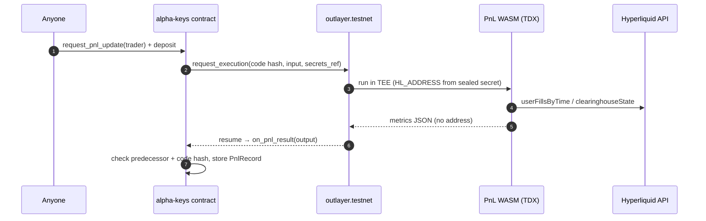
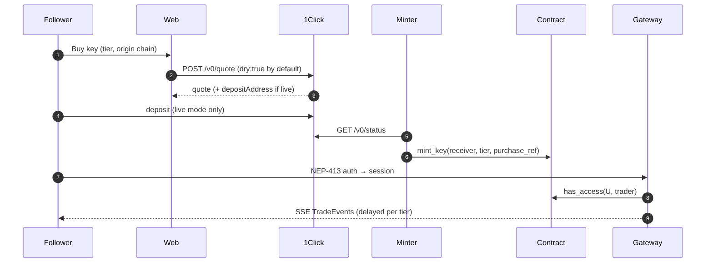

# Architecture

Times are written as UTC (MSK). This document describes the target design. Stubs in the repo follow the interfaces below; change this file in the same PR that changes an interface.

## 1. Components

| # | Component | Path | Stack (recommended, versions checked 2026-11-05) |
|---|---|---|---|
| 1 | NEAR contract `alpha-keys` | `contracts/alpha-keys` | Rust, `near-sdk` **5.30.0**, `near-contract-standards` **5.30.0**, build with `cargo-near` **0.22.x**, sandbox tests with `near-workspaces` **0.24.x** |
| 2 | PnL core library | `attestor/pnl-core` | Pure Rust, no I/O. Fixed-point metrics | 
| 2b | Feed sanitizer | `attestor/feed-core` | Pure Rust. Delay, size buckets, per-subscriber jitter. Depends only on `pnl-core` |
| 3 | TEE jobs (PnL attestor + feed) | `attestor/outlayer-job` | Rust → `wasm32-wasip2`, `outlayer` crate (SDK), deployed via `outlayer upload/deploy` |
| 4 | Feed gateway | `gateway` | TypeScript, Node 22+, Hono (HTTP + SSE), `near-api-js` **7.x** for view calls, NEP-413 verification |
| 5 | Copier agent | `copier` | Python 3.11+ with `uv`, reuses the baseline HL fleet client (or `hyperliquid-python-sdk`); pure policy module |
| 6 | Web app | `web` | Next.js (App Router) + TypeScript, `@hot-labs/near-connect` wallet connector, `near-api-js` 7.x, 1Click via `fetch` (or `@defuse-protocol/one-click-sdk-typescript` 0.1.x) |
| 7 | Minter relayer (small) | `gateway/src/minter.ts` | Polls 1Click `/v0/status`, calls `mint_key` with a function-call access key |

Why these choices:
- `near-sdk-rs` is NEAR's only official contract SDK, and `near-contract-standards` ships NEP-171/177/178/181/199 implementations, so we don't hand-roll an NFT.
- OutLayer is the only option among the candidates that runs our own code in a TEE, gives it sealed secrets, and calls back into a NEAR contract with the result. NEAR AI Cloud attests LLM inference, not arbitrary computation.
- Shade Agents are deprecated, so we don't use them.
- Python for the copier keeps Ilya's existing HL code reusable. If the fleet is TypeScript, switch the copier to TS. It talks to the rest of the system only through the gateway's SSE API, so the language choice is isolated.

## 2. Contract: `alpha-keys` (NEAR testnet; mainnet optional)

State (sketch):
```rust
pub struct AlphaKeys {
    owner_id: AccountId,
    outlayer_id: AccountId,                // "outlayer.testnet" | "outlayer.near"
    attestor_code_hash: String,            // sha256 of approved PnL WASM
    minters: UnorderedSet<AccountId>,      // relayers allowed to mint after 1Click SUCCESS
    traders: UnorderedMap<TraderId, Trader>,
    pnl: LookupMap<TraderId, Vector<PnlRecord>>,
    tokens: NonFungibleToken,              // near-contract-standards
    token_meta: LookupMap<TokenId, KeyMeta>,
}
pub struct Trader { id: TraderId, owner: AccountId, display_name: String,
                    price_live: U128, price_delayed: U128, royalty_bps: u16,
                    max_keys: u32, keys_sold: u32, active: bool }
pub struct KeyMeta { trader_id: TraderId, tier: Tier /* Live | Delayed60 */,
                     expires_at_ns: Option<U64>, purchase_ref: Option<String> }
pub struct PnlRecord { ts_ns: U64, window: String, pnl_usd_e6: I64Str, max_dd_bps: u32,
                       sharpe_e4: i32, n_trades: u32, equity_usd_e6: U64,
                       code_hash: String, input_hash: String, source: AttestSource }
pub enum AttestSource { OutLayerCallback { request_id: Option<String> },
                        OutLayerHttps { attestation_ref: String, relayer: AccountId } }
```

Methods (public interface):
| Method | Kind | Notes |
|---|---|---|
| `new(owner_id, outlayer_id, attestor_code_hash)` | init | |
| `register_trader(id, display_name, price_live, price_delayed, royalty_bps, max_keys)` | call, payable (storage) | Caller becomes the trader's owner. **Never takes an HL address.** |
| `request_pnl_update(trader_id)` | call, payable | Calls `outlayer.request_execution(...)` with `secrets_ref` set to the trader's sealed secret; callback `on_pnl_result` |
| `on_pnl_result(trader_id, #[callback_result] r)` | private | Parses the job output, checks `code_hash == attestor_code_hash`, appends a `PnlRecord` |
| `submit_pnl(trader_id, record)` | call | **Fallback path** (HTTPS mode). Only from accounts in `minters`/attestor relayers; stores `OutLayerHttps` source |
| `buy_key(trader_id, tier)` | call, payable (NEAR) | Trustless path: pays the trader owner (minus storage), mints the NFT to the caller |
| `ft_on_transfer(sender_id, amount, msg)` | NEP-141 receiver | Trustless USDC-on-NEAR path; `msg = {"trader_id","tier"}` |
| `mint_key(trader_id, tier, receiver_id, purchase_ref)` | call | `minters` only. Used after a 1Click payment reaches `SUCCESS`; `purchase_ref` = 1Click deposit address/quote id |
| `has_access(account_id, trader_id) -> Option<Tier>` | view | Used by the feed job and the gateway |
| `get_trader`, `list_traders`, `get_pnl_history(trader_id, from, limit)` | view | |
| NEP-171/177/178/181/199 methods | standard | `nft_transfer`, `nft_token`, `nft_tokens_for_owner`, `nft_payout`… |

Rules: keys can't be minted beyond `max_keys`. Expired keys return `None` from `has_access`. Royalty goes to the trader owner via NEP-199 `nft_payout`.

## 3. TEE jobs (OutLayer)

Both are one WASM binary with an `action` field in its input, or two projects if that turns out simpler.

**3a. PnL attestor** (`action: "pnl"`)
- Input (public): `{ "action":"pnl", "trader_id":"alpha-1", "window":"7d", "now_ms": 1731000000000 }`
- Secret (env, sealed via OutLayer secrets, access whitelisted to our project or contract): `HL_ADDRESS`
- Work: HTTPS POST to `https://api.hyperliquid.xyz/info` with `userFillsByTime` (`startTime` = `now_ms` minus the window), `clearinghouseState`, and `spotClearinghouseState`. Equity is perps account value plus spot USDC, so a withdrawal from perps to spot is not a 100% drawdown. Then `pnl-core::compute` on the fills inside the window. This build's worker returns an error from the live fetch. `{"fixture":true}` uses the committed fills instead, which is what the tests run.
- Output (stdout JSON): `{ "pnl_usd_e6", "max_dd_bps", "sharpe_e4", "n_trades", "equity_usd_e6" }`. The output must not contain the address or the raw fills.
- Trust: OutLayer's worker runs inside Intel TDX and binds the WASM sha256, input hash, and output. The contract only accepts the callback from `outlayer_id` and pins `attestor_code_hash`. See https://app.outlayer.ai/docs/getting-started and WORKER_ATTESTATION.md in https://github.com/out-layer/outlayer.

**3b. Feed job** (`action: "feed"`, called over the HTTPS API by the gateway)
- Input: `{ "action":"feed", "trader_id", "tier":"Live|Delayed60", "since_ms" }`
- Work: the live fetch is `userFillsByTime` with `startTime` = `now_ms` minus the window, the same bound as the PnL job. `feed-core::sanitize` then drops fills newer than `now - delay(tier)`, replaces size with a bucket (`0.01`, `0.1`, `1`, `10`, `10+`), rounds time down to 5 seconds, and subtracts a deterministic per-subscriber jitter so a leaked stream can be told apart. The gateway and `make demo-seed` call this library. The job does too. None of them learn the address from the library.
- The gateway checks entitlement before calling. For defense in depth the job can re-check `has_access` itself through NEAR RPC.

## 4. Feed gateway

- `POST /auth/challenge` → `{ nonce }`. `POST /auth/verify` takes a NEP-413 signed message `{ accountId, publicKey, signature, message, nonce, recipient:"alpha-keys" }`. It checks the signature over the NEP-413 payload, that `recipient` is `alpha-keys`, that the message names the account, and that the nonce has not been used. It returns a short-lived HMAC session token. The demo secret in `.env.example` is a public placeholder. A `view_access_key` check is left for a deployed account.
- `GET /feed/:traderId` (SSE). Checks access, then streams `TradeEvent`s. It returns **403** `no viewing key` when access is missing and **401** without a session.
- Judge mode is `DEMO_FEED=1` (the default in `.env.example`). `POST /demo/session` and `POST /demo/mint` grant a Delayed60 key in process memory, and the stream is `fixtures/feed/alpha-1.jsonl`. Set `DEMO_FEED=0` to turn those routes off. The process still has no Hyperliquid address.
- The judge gateway reads the committed fixture. It does not poll a job and it never sees the HL address.
- A 1Click minter that polls `/v0/status` and calls `mint_key` is not in this build. `mint_key` is on the contract for that relayer later.

```ts
// gateway/src/types.ts (shared contract with copier and web)
export type Tier = "Live" | "Delayed60";
export interface TradeEvent { traderId: string; seq: number; tsMs: number; coin: string;
  side: "B" | "A"; sizeBucket: string; px: string; reduceOnly: boolean; kind: "open"|"add"|"reduce"|"close"; }
```

## 5. 1Click buy flow (any chain → key)

1. Web: user picks a trader, a tier, and an origin asset. Web calls `POST https://1click.chaindefuser.com/v0/quote` with `dry: true` (default) and `destinationAsset` = USDC on NEAR (`nep141:17208628f84f5d6ad33f0da3bbbeb27ffcb398eac501a31bd6ad2011e36133a1`). Verify the asset id via `GET /v0/tokens`. The request sets `recipient` = the treasury account, `recipientType: "DESTINATION_CHAIN"`, and `refundTo` = the user's origin address.
2. Live mode (author-only, tiny amounts, behind `ONECLICK_LIVE=1`): same request with `dry: false`. The user sends `amountIn` to `depositAddress`, the gateway stores the pending purchase, the minter mints on `SUCCESS`.
3. Trustless alternative on NEAR: `ft_transfer_call` USDC → contract with `msg`, or `buy_key` with NEAR attached.
- Auth: optional partner JWT in `X-API-Key` (or `Authorization: Bearer`). Without it, 1Click adds a fee. Docs: https://docs.near-intents.org/integration/distribution-channels/1click-api/about-1click-api, …/authentication.

**Trader funding (confidential):** a one-off script sends a quote with `confidentiality: "basic"`, `destinationAsset` = Hyperliquid USDC `1cs_v1:hypercore:hip1:0x6d1e7cde53ba9467b783cb7c530ce054` (8 decimals, credited to the **perps** balance, 0.5 USDC minimum, 0.2 USDC fee), and `recipient` = the new HL address. Docs: …/1click-api/quickstart/confidential-swaps, …/1click-api/hyperliquid. **This is blocked until the jurisdiction question is resolved (PLAN.md).**

## 6. Copier agent

- Subscribes to the gateway SSE with the follower's session.
- `policy.py` is pure and fully unit-tested. Inputs: the `TradeEvent`, the follower's account state, and `Limits{max_notional_usd, max_leverage, max_daily_loss_usd, min_liq_distance_pct, allowed_coins, copy_ratio, kill_switch}`. Output: `Order | Reject(reason)`.
- Executor: places the order on the follower's own HL account with the follower's own API wallet key from env. **It never holds or asks for the trader's keys.** `--dry-run` is the default.
- Liquidation guard: after every fill it recomputes the distance to liquidation. If the distance drops below `min_liq_distance_pct`, it reduces the position or blocks new adds.
- Stretch: an Agent API policy wallet that enforces the same caps in a TEE (https://docs.agentsonintents.com/integration/agent-api/overview). Demo keys rotate, so this stays optional.

## 7. Web app

Pages: `/` (leaderboard with a Relayed or Attested badge, linking to the explorer tx when `NEXT_PUBLIC_PNL_TX` is set, and showing `code_hash`), `/t/[id]` (tiers, dry 1Click quote, copier transcript), `/feed/[id]` (403, then the fixture stream after the demo mint), `/verify` (relayed record, sha256 of the fixture line, and a control that flips one byte and shows NOT VERIFIED). Wallet: `@hot-labs/near-connect` (https://docs.near.org/tools/near-connect).

The web app is a Next.js server build hosted on Vercel. The feed gateway stays a separate Node process. The Vercel project does not set `NEXT_PUBLIC_GATEWAY_URL`, so a remote browser does not call its own localhost. Leaderboard and verify work from the fixture. Feed 403 and unlock are the local Quickstart.

## 8. Data flows





## 9. Threat model

| Threat | Impact | Mitigation (MVP) | Residual / honest note |
|---|---|---|---|
| **Order-book trace-back.** A key holder matches feed events to HL's public fills and recovers the address | Address deanonymized; free-riding or front-running | Delay tiers (Live is for a few high-priced keys only; others get 60 s or more). Size bucketing and jitter, timestamp rounding. Hold back reduce-only events until the position is closed. Optional rotation of the trader's sub-accounts. A per-trader cap on live keys | Can't be eliminated while HL is a public book. State it in the README |
| **Key sharing.** A holder re-broadcasts the feed | Revenue loss | Per-session watermarking (tiny per-subscriber jitter so a leak identifies the subscriber), a session concurrency limit of 1 per token, short JWT TTL | Re-broadcast of delayed data is cheap; pricing should assume some leakage |
| **Attestation trust.** A fake PnL is posted | Fraudulent leaderboard | Contract accepts the callback only from `outlayer_id`, with a pinned `attestor_code_hash`; the WASM is open source and reproducible; the HTTPS fallback is limited to a whitelisted relayer and labelled "relayed" in the UI | Trust in Intel TDX plus OutLayer's worker registration; the trader could run a different account (mitigation: the attestor also reports total deposits, so a cherry-picked history shows up) |
| **Address leak via logs or outputs** | Deanonymized | The address exists only as an OutLayer secret. Output schema review plus a test that fails if any `0x[0-9a-f]{40}` appears in the job output or gateway logs | |
| **Funding linkage** | Deanonymized | Fund only through a 1Click `confidentiality` swap; never send from a known wallet; withdraw the same way | Jurisdiction question open |
| **Copier overspend or liquidation** | Follower loss | Pure policy with caps, a liquidation-distance guard, a kill switch, dry-run default, and the follower's own keys only | Market gaps; the copier lags the trader by design |
| **Minter relayer misbehaviour** | Unpaid mints | Minter role limited to `mint_key`; a function-call access key with an allowance; `purchase_ref` stored on-chain for audit; the trustless NEAR/NEP-141 path also exists | |
| **Secrets in the repo** | Account compromise | `.env.example` only, gitleaks before push and before going public, `.gitignore` | |

## 10. References (fetched 2026-11-05)
- near-sdk-rs / standards: https://crates.io/crates/near-sdk (5.30.0), https://crates.io/crates/near-contract-standards (5.30.0), https://docs.near.org/smart-contracts/quickstart, https://docs.near.org/primitives/nft/standard
- JS API: https://docs.near.org/tools/near-api (near-api-js 7.x; near-kit alternative), wallet connector https://docs.near.org/tools/near-connect
- 1Click: https://docs.near-intents.org/integration/distribution-channels/1click-api/about-1click-api · /authentication · /quickstart/confidential-swaps · /hyperliquid · ToS https://docs.near-intents.org/security-compliance/terms-of-service
- OutLayer: https://app.outlayer.ai/docs/getting-started · https://app.outlayer.ai/llms.txt · contract `outlayer.testnet` / `outlayer.near`, HTTPS `https://api.outlayer.ai` (testnet `https://testnet-api.outlayer.ai`)
- NEAR AI Cloud: https://docs.near.ai/cloud/quickstart (`https://cloud-api.near.ai/v1`, OpenAI-compatible) · https://docs.near.ai/cloud/verification · https://docs.near.ai/cloud/private-inference
- Agent API (demo env): https://docs.agentsonintents.com/integration/agent-api/overview
- Shade Agents deprecation: https://docs.near.org/ai/shade-agents/getting-started/introduction
